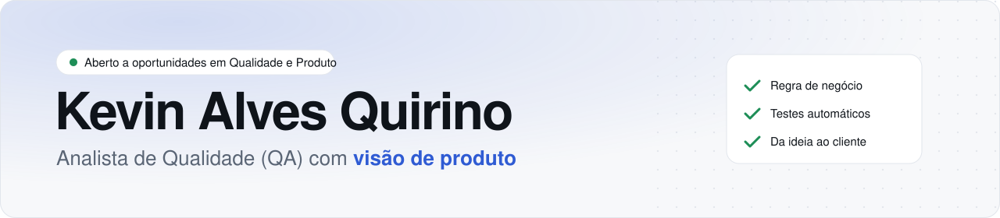

<picture>
  <source media="(prefers-color-scheme: dark)" srcset="assets/banner-escuro.svg">
  
</picture>

  
  
  

### Sobre mim

Analista de QA com visão de produto e experiência em produtos financeiros B2B e B2C, como crédito consignado e auditoria. Atuo do refinamento à automação: ajudo a definir regras de negócio e critérios de aceite, planejo os testes e automatizo jornadas web, mobile e de API. Também atuei como Product Owner de um sistema de auditoria. Aberto a oportunidades em **Qualidade** e **Produto**.

### Ferramentas

| | |
|---|---|
| **Testes** |       |
| **Produto** |     |
| **Entrega** |     |
| **Programação** |      |

### Projetos em destaque

**No trabalho** · dados protegidos. O código é da empresa, então cada projeto tem uma página explicando o que fiz, sem dados.

| Projeto | O que eu fiz | Em números |
|---|---|---|
| [Testes automáticos de um app de crédito](https://alvessq.github.io/cases/app-credito.html) | Automatizei login, simulação, ofertas e contratação no aplicativo, com testes que rodam no computador e na nuvem (Appium, WebdriverIO, testes de API) | 5 jornadas e 5 health checks de API · rodam no computador e na nuvem |
| [Testes do aplicativo rodando na nuvem](https://alvessq.github.io/cases/nuvem.html) | Fiz os testes do app rodarem num emulador Android na nuvem, disparados pelo painel, com vídeo de cada execução (CI com GitHub Actions, emulador Android, Appium) | 10 testes do app rodando na nuvem · 4 formas de rodar |
| [Separar bug de verdade de falha passageira](https://alvessq.github.io/cases/triagem.html) | Nos testes do computador, a falha é repetida 3 vezes e só vira chamado no Jira se falhar em todas (retry, testes flaky, Jira) | 3 bugs barrados em homologação · 4 alarmes falsos evitados |
| [Painel único de acompanhamento dos testes](https://alvessq.github.io/cases/painel.html) | Painel para rodar, agendar e acompanhar os testes do app, no computador e na nuvem, e os da auditoria (dashboard, React, Node.js) | 3 frentes num painel só · 13 testes acompanhados |
| [Monitoramento de um sistema de auditoria](https://alvessq.github.io/cases/auditoria.html) | Testes que conferem durante o expediente, no computador e pelo painel, se o sistema está no ar e montando as filas (Playwright, TypeScript, monitoramento) | 3 testes · 120 conferências de saúde por dia |
| [Product Owner do sistema de auditoria](https://alvessq.github.io/cases/po-auditoria.html) | Referência em regra de negócio, discovery, refinamentos e prioridades do time (discovery, refinamento, critérios de aceite) | PO por um período · Referência em regra de negócio |
| [Como propus a automação de testes do aplicativo](https://alvessq.github.io/cases/proposta.html) | Mostrei o valor da automação começando pequeno e construí a primeira versão (PoC, Appium, visão de produto) | Do zero até a primeira versão · 3 projetos que vieram depois |

**Projeto público** (código aberto, com a mesma abordagem)

| Projeto | O que é |
|---|---|
| [qa-automation-portfolio](https://github.com/alvessq/qa-automation-portfolio) | Testes automáticos de um app de compras para celular e de uma loja on-line, os dois públicos, e o painel que agenda e acompanha tudo. Encontrei 2 falhas reais no app. |

Clique no nome de um projeto para ler o case completo no meu [portfólio](https://alvessq.github.io).

### Como eu trabalho

1. Entender o negócio e o que não pode dar errado
2. Combinar com o time as regras do que é "pronto"
3. Planejar o que testar e de que jeito
4. Automatizar os testes que se repetem
5. Acompanhar o uso real e melhorar

### Vamos conversar?

Me chame no [LinkedIn](https://www.linkedin.com/in/kevin-alves-quirino-0942091b9/) ou pelo e-mail [kevinalvessq@gmail.com](mailto:kevinalvessq@gmail.com).
